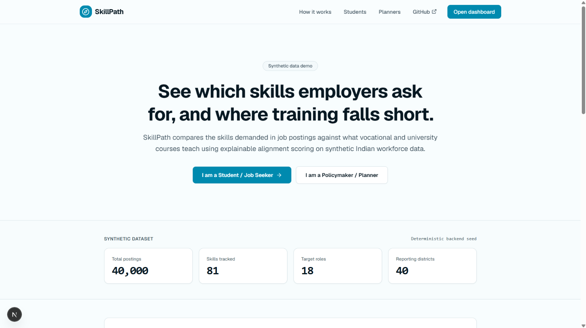
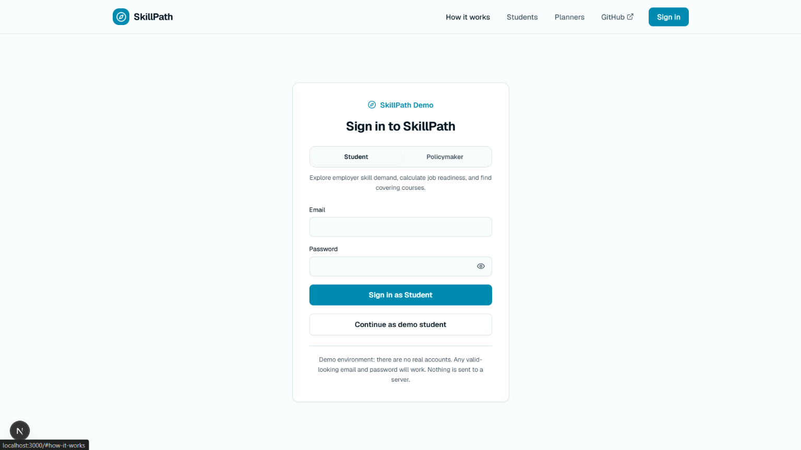
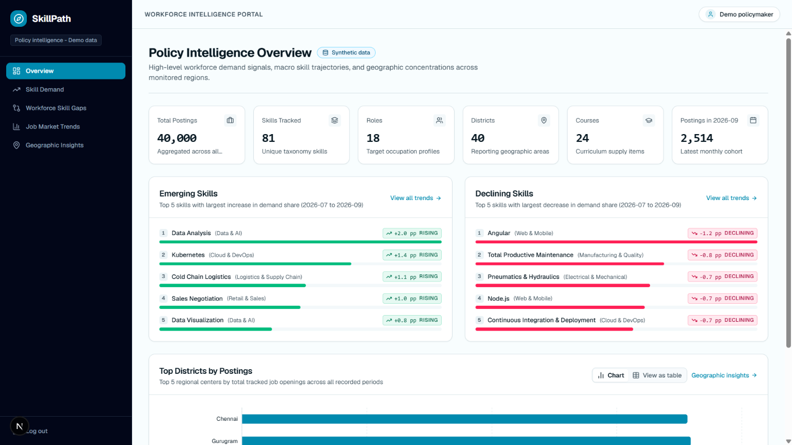
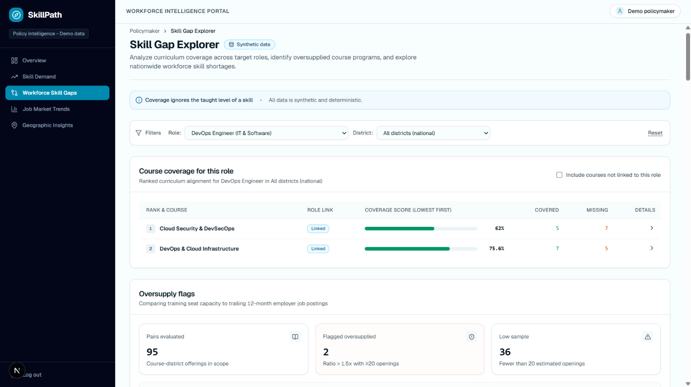
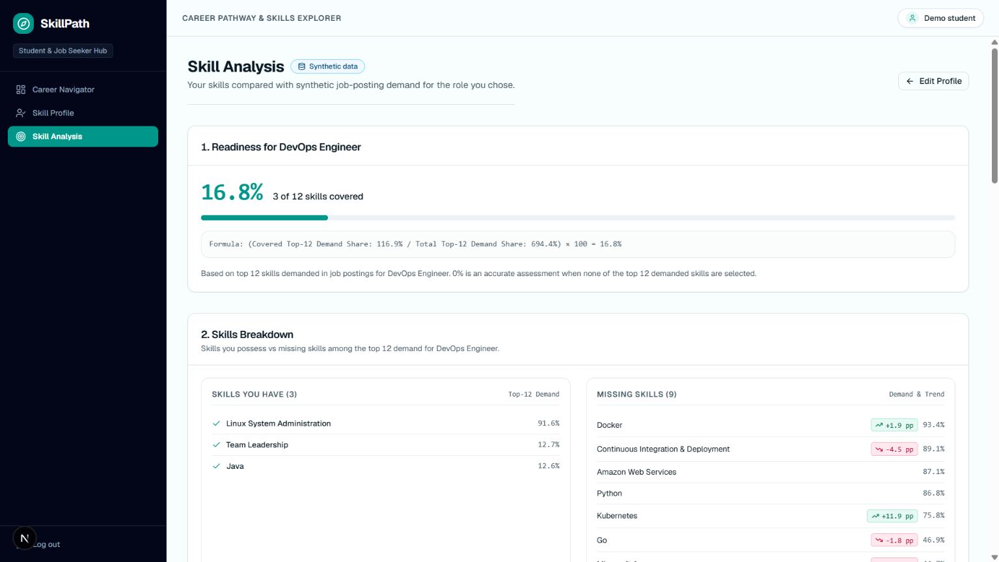
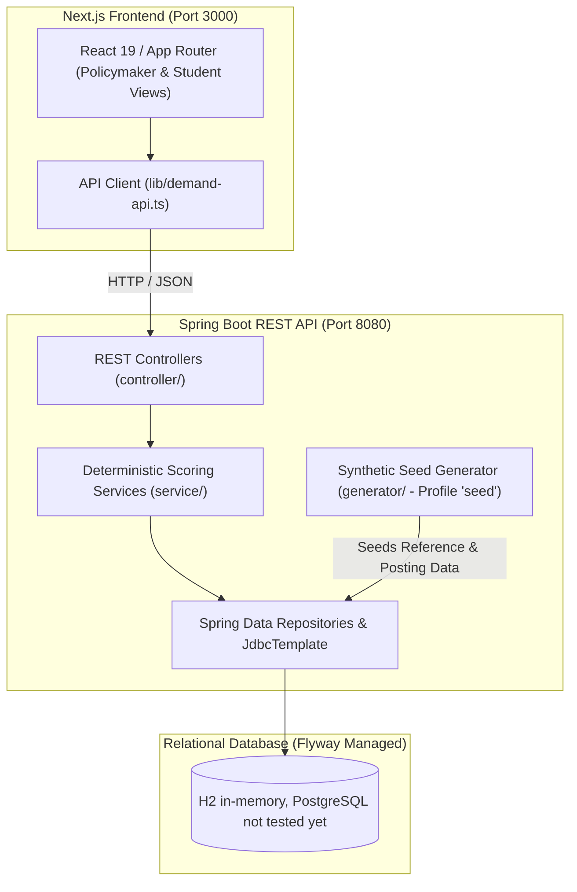

<div align="center">

# SkillPath 🧭

**Deterministic skill-demand alignment engine comparing vocational training curricula against synthetic labor-market demand across India.**

[](https://github.com/bhavadeepmanchala/skillpath/actions/workflows/ci.yml)
[](https://openjdk.org/)
[](https://spring.io/projects/spring-boot)
[](https://nextjs.org/)
[](https://flywaydb.org/)

[What it is](#what-it-is) • [Screenshots](#screenshots) • [Architecture](#system-architecture) • [Core Capabilities](#core-capabilities) • [Scoring](#how-the-scoring-works) • [API Reference](#api-reference) • [Project Organization](#project-organization) • [Quick Start](#quick-start) • [Testing](#testing) • [Deployment](#deployment) • [Limitations](#limitations) • [Roadmap](#roadmap)

</div>

> **Notice: Synthetic Data & Demo Authentication**  
> All data in SkillPath is entirely synthetic, generated by a seeded generator (seed 42). It contains no real employer, job posting, or placement records.  
> The login interface is demo-only: user roles are selected locally and stored in browser `localStorage`. There are no user accounts, passwords, or server-side authentication sessions.

---

## What it is

Vocational training programs frequently diverge from the skills sought by local employers, producing graduates for saturated roles while emerging technical demands remain unaddressed. SkillPath addresses this mismatch by quantifying employer skill demand across 18 roles and 40 districts, comparing hiring requirements against the curricula of 24 vocational courses. The platform provides two dedicated operational views: a policymaker dashboard for regional workforce intelligence and oversupply monitoring, and a student interface for career navigation and gap identification. All demand metrics, coverage indicators, and oversupply ratios are calculated deterministically by Java backend services, with the single exception of student readiness percentages which are evaluated in the frontend by weighting possessed skills against backend demand shares.

---

## Screenshots


| View | Description | Screenshot |
|---|---|---|
| Landing Page | National demand figures, rising skills strip, and scoring transparency breakdown |  |
| Login Interface | Demo role switcher for policymaker and student workflows |  |
| Policymaker Overview | National KPI summary, latest posting volume, and momentum indicators |  |
| Skill Gap Explorer | Course coverage rankings, oversupply ratio flags, and national skill shortages |  |
| Student Skill Analysis | Target role readiness %, missing skill priorities, and course recommendations |  |

---

## System Architecture



The Next.js client renders policymaker and student interfaces, communicating via HTTP fetch requests to Spring Boot REST controllers. Backend services execute deterministic SQL aggregations and mathematical scoring models via `JdbcTemplate` and Spring Data JPA. When started with the `seed` profile, the generator populates reference catalogs, 40,000 synthetic job postings across 18 months, and monthly aggregate tables into Flyway-managed relational storage.

---

## Core Capabilities

### Policymaker
1. **Overview (`/policy`):** High-level summary displaying national KPIs from `/api/demand/summary`, latest-month hiring volume, and top rising skills.
2. **Skill Demand (`/policy/skill-demand`):** Ranked in-demand skills by posting count and demand share from `/api/demand/skills` with role, district, and date filters.
3. **Skill Gap Explorer (`/policy/workforce-skill-gaps`):** Course coverage rankings from `/api/courses/{id}/alignment`, oversupply flags from `/api/flags`, and national skill shortages from `/api/alignment/gaps`.
4. **Job Market Trends (`/policy/job-market-trends`):** Emerging and declining skills by momentum delta from `/api/demand/trends` with drill-down monthly trend drawers from `/api/demand/skills/{id}/trend`.
5. **Geographic Insights (`/policy/geographic-insights`):** Posting volume distribution across 40 districts from `/api/demand/districts` with district-level share breakdowns.

### Student
6. **Career Navigator (`/student`):** Target role selection, top-15 employer skills checklist, client-computed readiness %, prioritized learning roadmap, and covering courses.
7. **Skill Profile (`/student/describe-myself`):** Target role selector and searchable multi-select catalog across 81 skills and 22 aliases, passing selections via URL parameters.
8. **Skill Analysis (`/student/skill-analysis`):** Client-computed readiness %, possessed versus missing skill breakdowns with trend badges, learning priorities, covering courses, and cross-role fit comparisons.

---

## How the Scoring Works

All metrics are deterministic, transparent, and verified through unit tests:

- **Demand Share:** The proportion of postings requiring a skill within a specified role, district, and time window:
  $$\text{Demand Share} = \frac{\text{Postings With Skill}}{\text{Total Postings in Scope}}$$
- **Trend (Momentum):** Absolute change in demand share between the latest window and the preceding window of equal length (default 3 months). A minimum posting guard (`skillpath.trends.min-postings=20`) excludes low-volume skills:
  $$\text{Momentum} = \text{Demand Share}_{\text{latest}} - \text{Demand Share}_{\text{previous}}$$
- **Course Coverage:** The share-weighted coverage of a target role's top-15 skills taught by a course (default 3-month window). Known limitation: ignores `taught_level` and treats any taught skill as covered:
  $$\text{Course Coverage} = \frac{\sum_{s \in \text{Covered Top-15}} \text{Demand Share}(s)}{\sum_{s \in \text{Top-15}} \text{Demand Share}(s)} \times 100$$
- **Oversupply Ratio:** Compares annual course seats against estimated job openings over trailing 12 months (`estimatedOpenings = postingsInWindow \times scalingFactor`, default scaling factor 1.0). A low-sample guard (`estimatedOpenings < 20`) suppresses noise from small districts. Flagged oversupplied when `ratio > 1.5` and `lowSample == false`:
  $$\text{Oversupply Ratio} = \frac{\text{Course Seats}}{\text{Estimated Openings}}$$
- **Gap Score:** Identifies national training shortfalls combining demand, absence in courses, and growth:
  $$\text{Gap Score} = \text{Demand Share}_{\text{last 3m}} \times (1.0 - \text{Course Coverage}) \times \text{Growth Factor}$$

### Worked Example: Oversupply Flag
A course in a district provides 100 seats. Job postings for linked roles in that district total 40 over trailing 12 months with a 1.0 scaling factor ($\text{estimatedOpenings} = 40 \times 1.0 = 40$).
$$\text{Oversupply Ratio} = \frac{100}{40} = 2.50$$
Because estimated openings (40) satisfy the minimum threshold ($\ge 20$), `lowSample` is false. With a ratio of 2.50 exceeding the 1.5 threshold, the offering is flagged as `oversupplied = true`.

Formulas are verified in test suites including `CourseControllerTest`, `DemandControllerTest`, `DemandTrendsControllerTest`, `FlagControllerTest`, `AlignmentControllerTest`, and `CoursePatternsIntegrationTest`.

---

## API Reference

| Method | Path | Parameters | What it returns |
|---|---|---|---|
| `GET` | `/api/roles` | None | List of roles (`id`, `name`, `sector`) sorted by name |
| `GET` | `/api/skills` | None | List of skills (`id`, `name`, `category`, `aliases`) sorted by name |
| `GET` | `/api/courses` | None | List of courses (`id`, `name`, `sector`, `durationWeeks`, `skillCount`, `linkedRoleCount`) |
| `GET` | `/api/courses/{id}/alignment` | `role` (required), `district`, `topN`, `windowMonths` | Course coverage score (0–100), postings in scope, covered skills, and missing skills |
| `GET` | `/api/flags` | `district`, `minOpenings` | Course-district oversupply ratios, estimated openings, lowSample flags, and thresholds |
| `GET` | `/api/alignment/gaps` | None | Top 10 national skill gaps with demand share, course coverage, and growth factors |
| `GET` | `/api/demand/summary` | None | System KPIs: total postings, skills, roles, districts, courses, and latest month postings |
| `GET` | `/api/demand/skills` | `role`, `district`, `from`, `to`, `limit` | Ranked in-demand skills with posting counts and demand shares |
| `GET` | `/api/demand/skills/{id}/trend` | `role`, `district`, `from`, `to` | Monthly historical posting count and share trend points for a specific skill |
| `GET` | `/api/demand/trends` | `role`, `district`, `window`, `limit` | Top rising and declining skills by momentum change with window date ranges |
| `GET` | `/api/demand/districts` | `from`, `to` | Postings by district and percentage share of total volume |

---

## Project Organization

```
skillpath/
├── backend/
│   ├── src/main/java/com/skillpath/backend/
│   │   ├── controller/         # REST API endpoints
│   │   ├── dto/                # Request and response records
│   │   ├── exception/          # Custom exceptions and error handlers
│   │   ├── generator/          # Seeded synthetic data generator
│   │   ├── model/              # JPA entity classes
│   │   ├── repository/         # Spring Data JPA repositories
│   │   └── service/            # Deterministic scoring and aggregation services
│   ├── src/main/resources/
│   │   ├── db/migration/       # Flyway SQL migration scripts
│   │   └── application.properties # Server and scoring configuration
│   ├── Dockerfile              # Multi-stage production container build
│   └── pom.xml                 # Maven build file with Java 21 dependencies
├── frontend/
│   ├── app/                    # Next.js App Router pages and layouts
│   │   ├── policy/             # Policymaker analytics views
│   │   ├── student/            # Student navigator and analysis views
│   │   ├── login/              # Demo role switcher
│   │   └── page.tsx            # Landing page
│   ├── components/             # Reusable UI cards, tables, drawers, and charts
│   ├── lib/                    # API client and local auth helpers
│   └── package.json            # Next.js 16 dependencies and build scripts
├── assets/
│   └── screenshots/            # UI screenshots gallery directory
└── run-demo.bat                # Windows PowerShell one-click demo startup script
```

---

## Quick Start

### Method 1: Automated Script (`run-demo.bat`)
Run the script from the repository root in Windows:
```cmd
run-demo.bat
```
- Starts the Spring Boot backend on port 8080 with the `seed` profile.
- Starts the Next.js development server on port 3000.
- Waits 45 seconds for backend compilation and database initialization, then opens `http://localhost:3000`.
- Data is held in an in-memory H2 database and resets whenever the backend terminates.

### Method 2: Manual Startup

**Terminal 1 — Backend (Spring Boot):**
```powershell
cd backend
.\mvnw.cmd spring-boot:run -Dspring-boot.run.profiles=seed
```
Expected output:
```
Seeded row counts for all 14 tables: skill=81, skill_alias=22, role=18, district=40, job_posting=40000, posting_skill=284188, course=24, course_skill=129, course_role=27, course_offering=190, placement_outcome=190, employer_validation=0, demand_monthly=128205, training_plan=0
... Started BackendApplication in ... seconds
```

**Terminal 2 — Frontend (Next.js):**
```powershell
cd frontend
npm install
npm run dev
```
Expected output:
```
- Local: http://localhost:3000
... Ready in ... ms
```

---

## Testing

Run unit and integration test suites using the Maven wrapper:
```powershell
cd backend
.\mvnw.cmd test
```

**Results:** 77 tests passing, 0 failures, 0 errors.

**Test Coverage:**
- REST controllers: parameter parsing, validation exceptions, 400/404 handling.
- Seeded generator: reproducible RNG streams, catalog integrity, banned API checks, and pattern distributions.
- Deterministic scoring: demand share denominators, momentum deltas, sample-size guards, course coverage calculations, and oversupply ratio thresholds.

---

## Deployment

- **Frontend:** Hosted on Vercel, deploying the Next.js App Router application.
- **Backend:** Hosted on Render (free tier) via Docker.
- **Container Build:** `backend/Dockerfile` executes a multi-stage build using Eclipse Temurin 21 JDK (`./mvnw clean install -DskipTests`) and runs `java -jar app.jar` on Eclipse Temurin 21 JRE, exposing port 8080.
- **Free-Tier Inactivity:** The Render backend container spins down after inactivity. Initial requests after an idle period take 30–60 seconds while the instance boots and initializes.

### Required Environment Variables

**Backend:**
- `DB_URL`: JDBC connection URL (defaults to in-memory H2 when unset).
- `DB_USERNAME`: Database username.
- `DB_PASSWORD`: Database password.
- `SPRING_PROFILES_ACTIVE`: Set to `seed` to run synthetic data generation on startup.
- `GEMINI_API_KEY`: API key for legacy v1 `/api/analyze` fallback.

**Frontend:**
- `NEXT_PUBLIC_BACKEND_URL`: URL of the backend API (defaults to `http://127.0.0.1:8080` when unset).

Live demo URL: `<LIVE_FRONTEND_URL>`

---

## Limitations

- **Synthetic Data:** All 40,000 job postings, courses, offerings, and outcomes are artificially generated by a seeded generator (seed 42). The system contains no real employer, job, or placement data.
- **Demo-Only Login:** Authentication is simulated via browser `localStorage` to switch between demo roles. There are no user accounts, password checks, or server-side sessions.
- **In-Memory Storage Locally:** Local instances run against an in-memory H2 database; all seeded records reset when the application process stops.
- **PostgreSQL Untested:** Database schemas and Flyway migrations are designed for PostgreSQL, but runtime queries and performance have only been executed against H2.
- **Native SQL Queries:** Demand and trend aggregations execute native SQL via `JdbcTemplate` that has not been validated against strict PostgreSQL dialect modes.
- **Course Coverage Ignores Proficiency:** Coverage scoring evaluates binary presence of a skill in a course, omitting required versus taught proficiency levels (`taught_level`).
- **Client-Side Student Readiness:** Student readiness percentages are computed inside React components from individual skill demand shares rather than a dedicated backend API.
- **Unsaved Student Selections:** Student checklist ticks and profile selections persist only in browser `localStorage` or URL query parameters.
- **Parallel Client-Side Alignment Requests:** The frontend issues up to 24 parallel requests to `/api/courses/{id}/alignment` because no bulk alignment endpoint exists.
- **Legacy v1 Backend Code:** `AnalyzeController` (`/api/analyze`), `SkillMatchService`, `GeminiService`, and `data.json` remain in the backend solely to keep the legacy v1 deployment functional; no v2 frontend pages call them.

---

## Roadmap

- Employer validation workflow to confirm or dispute detected skill demand.
- Gemini-powered plain-text explanations for v2 scores and reports.
- Obsolete-course detection flags combining low alignment coverage with negative skill trends.
- Curriculum update recommendations identifying skills to add or retire per course offering.
- District training plans for seat capacity and trainer resource allocation.
- PostgreSQL production testing and validation.
- Automated CI pipeline for pull request verification.
- Bulk course alignment endpoint to consolidate parallel client requests into a single query.
